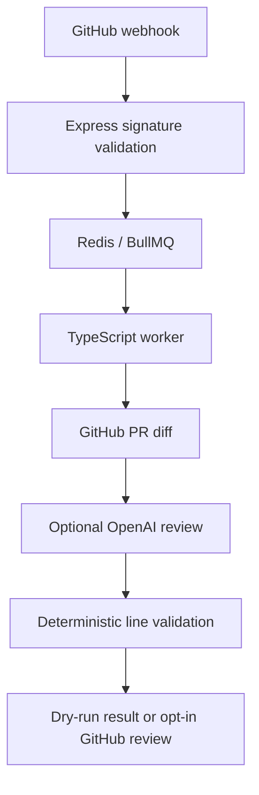

# PR Review Service

A portfolio-scale, event-driven GitHub pull request review prototype. It accepts signed webhook events, queues review work in Redis/BullMQ, retrieves changed files, optionally asks an LLM for findings, validates their locations, and optionally posts an advisory review. It never merges or approves a PR.

## Architecture



## Getting started

1. Install Docker with Compose, or Node 22 (recommended; Node 20.15.1 also supported by the test runner) and Redis 7.
2. Copy `.env.example` to `.env`. Set `GITHUB_REPOSITORY` to a repository you control, generate a random webhook secret (`openssl rand -hex 32`), and set a narrowly scoped GitHub token with pull request read permission (write only if posting reviews). Never commit `.env`.
3. Run `docker compose up --build`. Check `curl http://localhost:3000/health`.
4. Configure a GitHub repository webhook for pull request events, JSON content type, and the same secret. Use a trusted HTTPS tunnel or HTTPS reverse proxy to expose `/webhooks/github`; local loopback alone is not reachable by GitHub.
5. Open or update a test pull request. Inspect `docker compose logs -f api worker`.

Default `REVIEW_MODE=dry-run` fetches patches but does not send them to an LLM or post findings. For AI analysis, set `REVIEW_MODE=ai` and `OPENAI_API_KEY`; leave `POST_COMMENTS=false` to keep findings in BullMQ job results. Only enable `POST_COMMENTS=true` on a test repository after inspecting results. AI mode sends selected code diffs to the configured external model provider; obtain authorization before using private code. Model output is advisory, not proof of correctness.

## Local checks

```sh
npm install
npm test
npm run typecheck
```

For local non-Docker execution set `REDIS_URL=redis://localhost:6379` in `.env`, start Redis, and use `node --env-file=.env --import tsx src/api.ts` and `node --env-file=.env --import tsx src/worker.ts` in separate terminals.

## Engineering decisions

- HMAC verification uses the original request bytes and constant-time comparison. The repository allowlist restricts accepted events.
- An asynchronous worker keeps expensive model calls out of the webhook request path. A SHA-derived job ID deduplicates events for a PR revision while job records are retained. Retries use exponential backoff.
- Head SHA checks reduce stale reviews. Posting includes the reviewed commit SHA, and a review marker reduces duplicates after retry. Exactly-once external posting is not guaranteed across failures or concurrent external writers.
- Model findings are restricted to actual added lines, allowed severity values and bounded messages. This is structural validation, not semantic validation of a claimed bug. Diffs are untrusted model input; prompts cannot eliminate prompt injection risk.
- JSON logs report latency, file counts and job outcomes. Redis persistence is enabled for the local demo. CI checks types, runs unit tests, and builds a container; continuous deployment is not configured.
- Review scope is capped at 300 files and 50,000 patch characters. Binary, unavailable and oversized patches may be skipped. The system does not retrieve full repository context or perform comprehensive security analysis.

## Verification and limitations

Three core unit tests pass in Node 22. Dependency installation, full type-checking, Docker build, Redis integration, live model calls, and GitHub webhook/posting were not verified in the creation environment. CI is provided to run the additional checks. Dependencies are not lockfile-pinned yet; generate and commit a lockfile after successful installation. Before production use, add integration tests, request throttling, authenticated status access, metrics/alerts, job retention policy, secret management, and stronger idempotency. This is a learning prototype, not a production-ready CodeRabbit substitute.

## Engineering Trade-offs

- **Asynchronous processing:** Decouples webhook acknowledgment from computationally expensive code review operations.
- **Job deduplication:** Uses deterministic, commit-based job identifiers to minimize redundant processing.
- **Fault tolerance:** Implements retries with exponential backoff to handle transient failures.
- **AI reliability:** Validates generated findings against actual changed source-code lines while recognizing that structural validation does not guarantee semantic correctness.
